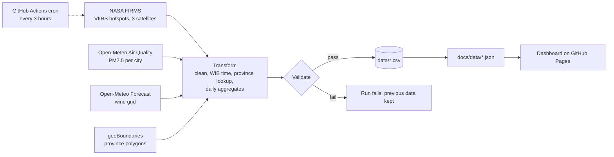

# Indonesia Haze Monitor

[](https://github.com/Din131/indonesia-haze-monitor/actions/workflows/update.yml)
[](https://github.com/Din131/indonesia-haze-monitor/actions/workflows/tests.yml)

An automated pipeline and dashboard that tracks **forest-fire hotspots**, **haze (PM2.5)** and **wind** across Indonesia, refreshed every 3 hours.

**Dashboard:** https://din131.github.io/indonesia-haze-monitor/

It runs entirely on GitHub: Actions schedules and runs the pipeline, the repository stores the data, and Pages hosts the dashboard.

## Architecture



| Step | What it does | Code |
|---|---|---|
| Extract | Reads the last 48 hours of VIIRS detections for the Indonesia bounding box from three satellites, hourly PM2.5 for 12 cities, and current wind on a grid over Sumatra and Kalimantan | [`haze/extract.py`](haze/extract.py) |
| Transform | Drops low-confidence detections, converts UTC to WIB, assigns each hotspot to a province (Indonesian names) with a point-in-polygon test, and builds daily counts per province | [`haze/transform.py`](haze/transform.py), [`haze/geo.py`](haze/geo.py) |
| Validate | Blocks the load on duplicates, points outside Indonesia, future timestamps, negative fire power, implausible PM2.5 or missing cities | [`haze/validate.py`](haze/validate.py) |
| Load | Keeps 7 days of detailed hotspots, a growing history of daily counts per province and hourly air quality, then publishes JSON for the dashboard | [`haze/load.py`](haze/load.py) |
| Orchestrate | Every 3 hours; tests run before each load; data is committed only when it changed | [`.github/workflows/update.yml`](.github/workflows/update.yml) |

## Data

| File | Grain | Retention |
|---|---|---|
| `data/hotspots_recent.csv` | one row per satellite detection | rolling 7 days |
| `data/hotspots_daily_by_province.csv` | date (WIB) × province | full history |
| `data/air_quality_hourly.csv` | hour (WIB) × city | full history |
| `data/run_log.csv` | one row per pipeline run | full history |

Re-reading a 48-hour window and merging on a stable key makes every run idempotent: repeated or overlapping runs never double-count.

## Limitations

- Satellite hotspots are thermal anomalies. Most are fires, but some can be other heat sources, and fires under thick cloud or smoke can be missed.
- PM2.5 comes from the CAMS global atmospheric model, not from ground sensors.
- This is an independent portfolio project, not an official source. For official information see [SiPongi (KLHK)](https://sipongi.kemenlhk.go.id) and [BMKG](https://www.bmkg.go.id).

## Run it locally

Requires Python 3.10+ and a free [NASA FIRMS MAP_KEY](https://firms.modaps.eosdis.nasa.gov/api/map_key/).

```bash
python -m unittest discover -s tests -t .    # offline tests
FIRMS_MAP_KEY=your_key python -m haze.run
```

## Data sources and credits

- Fire hotspots: NASA FIRMS, VIIRS 375 m (Suomi NPP, NOAA-20, NOAA-21)
- Air quality and wind: [Open-Meteo](https://open-meteo.com) (CAMS), CC BY 4.0
- Province boundaries: [geoBoundaries](https://www.geoboundaries.org), CC BY 4.0
- Base map: © OpenStreetMap contributors

## Author

**Pradito Nazaruddin**, Data Engineer · [Portfolio](https://din131.github.io) · [LinkedIn](https://www.linkedin.com/in/pradito-nazaruddin-65015b162)
